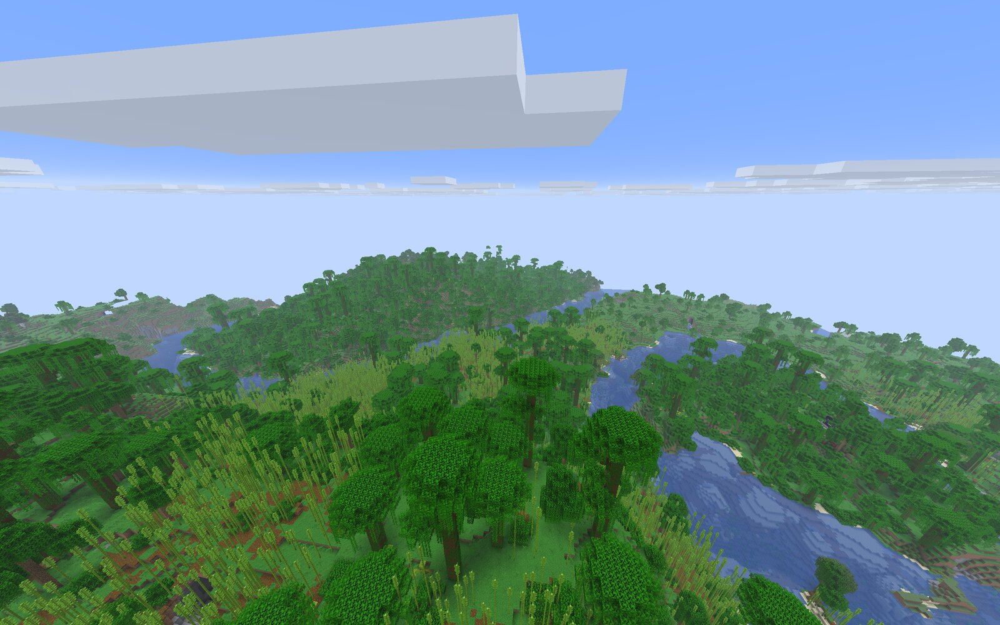
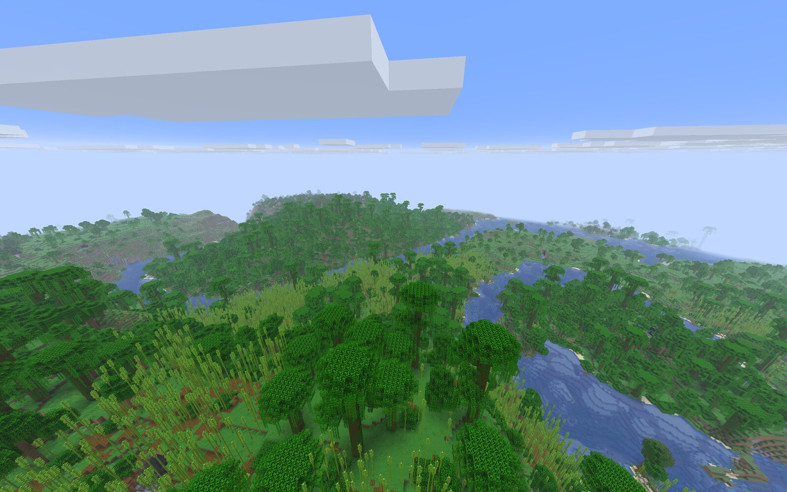

# ezzmc — a fast Minecraft Java Edition client written in Rust

> An open-source, privacy-first **Minecraft Java client in Rust** built on **wgpu / Vulkan**, with an optional **GPU-driven renderer** (compute culling, Hi-Z occlusion, multi-draw indirect). Offline mode or Microsoft sign-in through a separate launcher. Goal: join servers of **any version, from 1.5.2 to the latest**.

<p align="center">
  
  <br>
  <sub>ezzmc, render distance 32, GPU-driven (compute) renderer, vanilla 26.3 server.</sub>
</p>

**Status:** working prototype. Version **26.3** works today; other versions are in progress (see [Version support](#version-support)).

## Goals

1. **Maximum performance.** Rust core, `wgpu` rendering, networking and meshing on their own threads.
2. **Join any server.** Protocol support for every version from 1.5.2 to latest, including `online-mode=false` servers.

Behaviour is **vanilla**: Mojang's decompiled source for each version is the reference. No gameplay "improvements".

## Principles

- **Offline or launcher sign-in.** Pick a name and join `online-mode=false` servers. For online-mode servers, sign in with Microsoft through the separate launcher (`crates/launcher`). Chat is unsigned.
- **Privacy.** The client talks only to the server you connect to.
- **Vanilla behaviour.** Mechanics, physics and world generation results match the original.

## Render modes

Toggle with **F8** (or start with `--compute-renderer`).

| | Vanilla path (default) | Compute (GPU-driven) |
|---|---|---|
| How it works | Like the original: the CPU builds the visible list and submits it | The GPU decides visibility: frustum + Hi-Z culling, multi-draw indirect |
| Pros | Runs everywhere, reference picture | Faster on weak GPUs and at high render distance; faster when standing or turning |
| Cons | A weak GPU becomes the bottleneck | Needs `MULTI_DRAW_INDIRECT_COUNT` and compute shaders; up to ~9% slower in flight on a strong GPU |

<table>
  <tr>
    <td width="50%"><br><sub><b>Vanilla path</b></sub></td>
    <td width="50%"><br><sub><b>Compute path</b></sub></td>
  </tr>
</table>

The two shots are taken from the same spot; clouds differ only because they keep moving between captures.

## Benchmarks

Frame time in ms (**lower is better**). Test bed: vanilla Paper 26.3 server, all sections loaded, camera flying back and forth, one client, `vsync=off`.

| GPU | Render distance | Scenario | Vanilla path | Compute |
|---|---|---|---|---|
| RTX 5060 Laptop | 32 | standing | 2.8 | **1.9** |
| RTX 5060 Laptop | 32 | rotating in place | 2.39 | **1.83** |
| RTX 5060 Laptop | 32 | flight | **4.04** | 4.40 |
| RTX 5060 Laptop | 8 | flight | 1.00 | 1.03 |
| Radeon 780M (iGPU) | 32 | flight | 5.35 | **4.13** |

Takeaways: on a strong discrete GPU the modes are close (compute is ~9% slower in flight, ~3% at distance 8, within noise), while on a weak integrated GPU compute is clearly faster.

Caveats: the Radeon run is a single short run (~10 s per mode, mode order not alternated); the picture was compared against vanilla only on an empty scene; run-to-run noise is around 0.4 ms.

## What makes it fast

**Highlights**
- **GPU-driven rendering:** section visibility is decided on the GPU (frustum + Hi-Z occlusion), the world is drawn with multi-draw indirect.
- **Everything heavy off the main thread:** meshes are built and converted in a `rayon` pool; networking runs on plain threads with `crossbeam` channels, no async runtime.
- **Less work per frame:** draw-list cache (not rebuilt while the camera is still), per-frame budget for transparent-quad re-sorting, nearest-first section rebuild queue.

**World and meshing**
- Palette-based block storage per chunk section and a packed 16-byte vertex: less memory and GPU traffic.
- Cave culling over the section visibility graph and hidden-face culling between blocks, as in the original.
- Ambient-occlusion table generated from Mojang's source; light is recomputed by an own client-side light engine.
- Dropped items are drawn with GPU instancing: the model is stored once in VRAM, 80 bytes per copy.

**Resources and build**
- Assets are memory-mapped (`memmap2`); packet compression uses `libdeflater`.
- Entities live in flat arrays, no ECS.
- Release build: `lto="fat"`, `codegen-units=1`, `panic=abort`. A `fast` profile exists for development.
- Built-in frame profiler: set `EZZMC_PROF=1`.

## Tech stack

| Area | Choice |
|---|---|
| Language | Rust (stable) |
| Window and GPU | `winit` + `wgpu` (Vulkan) |
| Math | `glam` |
| Networking | threads + blocking sockets + `crossbeam-channel` |
| Compression | `libdeflater` |
| Parallelism | `rayon` |
| Logging and errors | `tracing` / `thiserror` |

## Project layout

Cargo workspace:

- `crates/protocol` — packets and protocol versions
- `crates/net` — networking layer
- `crates/world` — world, chunks, lighting
- `crates/mesh` — chunk meshing
- `crates/render` — renderer
- `crates/launcher` — launcher: online sign-in, server list, ping
- `crates/assets` — game assets
- `crates/client` — the client and entry point

## Build and run

Requires Rust 1.85 or newer.

```sh
cargo build --profile fast -p ezzmc-client
./target/fast/ezzmc-client --connect 127.0.0.1:25565
```

`--connect host:port` sets the server address. The protocol version is detected automatically from the server's ping reply.

Useful environment variables: `EZZMC_RENDER_DISTANCE`, `EZZMC_VSYNC=0`, `EZZMC_PROF=1`.

## Version support

- **Works:** Minecraft **26.3** (latest) — the main target, all development and testing happens here.
- **Partial:** 1.21.11 — a connection was made, but it has not been tested thoroughly.
- **Does not connect yet:** everything else from **1.5.2 to 26.2**. Protocol code for older versions is in progress but not verified against live servers. The goal of joining any server from 1.5.2 to latest is **not reached yet**.

### Implemented (on 26.3)

Ported from Mojang's source; the list reflects what exists in the code. Not every piece has been checked in live play yet.

- **World:** chunk streaming and storage, vanilla lighting (own client-side light engine), sky, fog, clouds, weather, lightning, biome colours, particles, render distance up to 32.
- **Player:** walking, sprinting, flying, physics and collisions, boats, third-person camera, status effects with HUD icons, armor rendering.
- **Blocks:** breaking and placing, block entities: chests (single/double, lid animation), signs (both sides, glow), banners, skulls, bells, enchanting-table book, pistons.
- **Mobs (~80 types):** farm animals, hostile mobs (creeper, spider, enderman, blaze, ghast, slime, witch, illagers, piglins, hoglin, guardian, phantom, ravager, warden, shulker, breeze, creaking, …), villagers and golems, horses/camel/llama/goat/sniffer, fish, bees, parrots, bats, frogs, axolotl, armadillo, and the bosses **Wither** and **Ender Dragon** (flight animation). Mobs, chests and dropped items are GPU-instanced (thousands on screen at ~300 FPS).
- **Inventory and screens:** inventory, creative menu, chests, furnace/brewing, enchanting, anvil, loom, villager trading, beacon, lectern and books, sign editor, server dialogs, boss bars, tab list, tooltips.
- **Menus:** main menu, options, key bindings, resource-pack manager (drag and drop), F3 debug screen, hitboxes (F3+B), disconnect screen.
- **Chat:** unsigned chat, command suggestions.
- **Audio:** sounds and music (not yet verified by ear).
- **Networking:** offline login, Microsoft sign-in through the launcher, encrypted connection, server list ping.

### Not done yet

- **Other versions (the main goal):** only 26.3 works; 1.5.2–26.2 do not connect yet.
- **Singleplayer / integrated server:** not started.
- **Verification:** the vanilla side-by-side acceptance pass is still in progress; audio is not checked by ear; some creative-menu icons are missing; several rarer mob variants (e.g. baby/adult forms of a few animals) are partial.
- **Known vanilla differences on 26.3:** some newer play packets are ignored (`game_rule_values`, `swing_animation`, `post_effects`, …); fluid counters in sections are not tracked; `force_translucent` texture material flag is not ported; old golden tests are not updated for 26.3.
- **Rendering:** on a strong GPU the compute path is ~9% slower than the vanilla path in flight (see [Benchmarks](#benchmarks)).

The project is under active development: a working prototype, not a finished client. Some mechanics already work, others are still being ported from the reference.
